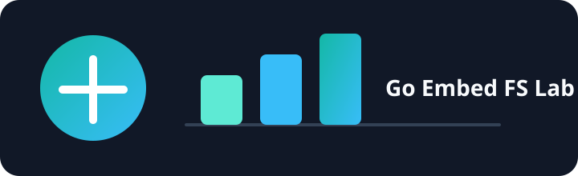

## 🔎 Overview
Learn how Go embeds local assets into a program and how the io/fs helpers browse those embedded files.

## ✨ Features
- 📦 Embeds sample files at compile time with the standard library
- 🗂️ Lists embedded entries with fs.ReadDir and fs.WalkDir
- 🔎 Matches files with fs.Glob and reads a sub-filesystem with fs.Sub
- 🧩 Uses no third-party dependencies

## 🎬 Demo
No hosted demo is published. Run the project locally using the Quick Start command below.

## 🚀 Quick Start
    go run .

## 🧰 Tech Stack
- Go 1.22+
- Go standard library
- embed and io/fs

## 🗂️ Folder Structure
    main.go                 Embed and filesystem demonstrations
    assets/                 Embedded sample files
    assets/docs/            Nested documentation examples
    go.mod                  Module metadata

## 🛣️ Roadmap
- [ ] Add a flag to select a subdirectory
- [ ] Show file sizes and MIME hints

## 🤝 Contributing
Issues and pull requests are welcome. Keep changes focused, document behavior, and add a small reproducible example for new features.

## 📄 License
Released under the MIT License. See LICENSE.

